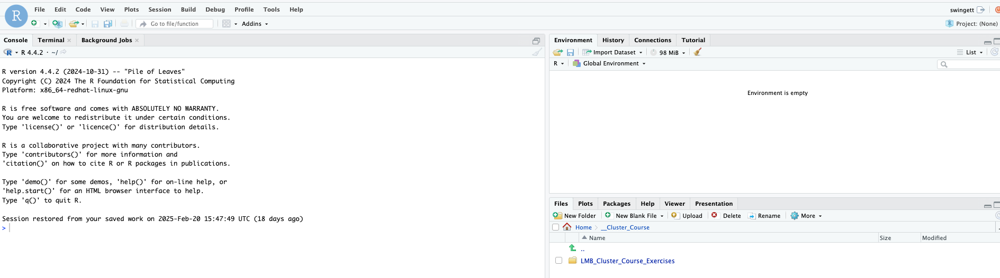
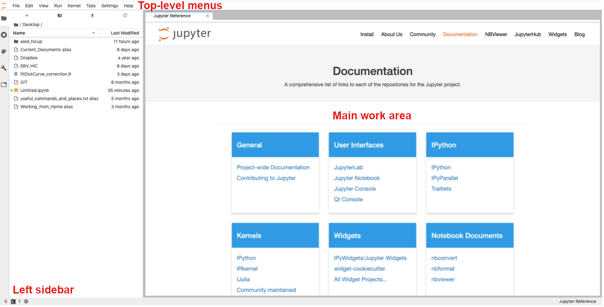
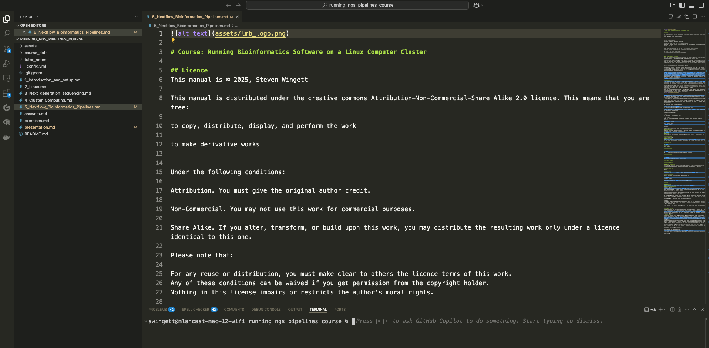

---

* [Introduction & Setup](1_Introduction_and_setup.md)
* [Linux – using the Linux operating system and the command line](2_Linux.md)
* [Data and Software – where to store files and how to run software](3_Data_and_Software.md)
* [Cluster Computing – how to submit jobs to a compute cluster](4_Cluster_Computing.md)
* [Course Exercises](exercises.md)
* [License](./License.md)

---

# Data and software

## Where to store data

There are 5 main areas where people can store files on the cluster

1. `~` (home directory) - your data allocation here is relatively small.  We recommend only storing configuration files and scripts here.

2. `/cephfs` - very large data storage (2.9PB - total for all users). A suitable location for processing data.

3. `/cephfs2` - very large data storage (5.7PB - total for all users). A suitable location for processing data.

4. `/scratch` - very large data storage (1.1PB - total for all users). A suitable location for processing data.  Please note: **FILES ARE AUTOMATICALLY DELETED FROM HERE AFTER A SET PERIOD OF TIME - DON'T STORE FILES HERE!**  Process data here and then copy the results to another location.  **The scratch filesystem is not compatible with running Nextflow / nf-core pipelinse.  Try running these in `/cephfs` or `/cephfs2.`**

5. `/istore` or `/isilon` - a place to store data

**PLEASE REFER TO IT/SCIENTIFIC COMPUTING FOR GUIDANCE ON WHERE TO STORE DATA SAFELY.**

<b>Do you have sequencing data?  The Cell Biology Division has a dedicated storage location for FASTQ sequencing files.  Please let us know if you wish to deposit data here.</b>

### Checking current storage

Although drives on the cluster have massive storage capacities, they can fill up!  When approaching capacity (>90% full) some software may fail when running.  To check how full a partition is, run the command:

    df -H | grep [drive name]

**Your current usage can be checked at:**
**<https://bb8.mrc-lmb.cam.ac.uk/userdash/userdash.cgi>**

For more details on storage locations, please refer to Scientific Computing:
<https://www.mrc-lmb.cam.ac.uk/scicomp-new/index.php?id=data-storage>

**The Scientific Computing webpages also provide instructions on how to create a folder for yourself in `/cephs` etc.**

## Transferring files to and from the cluster using the command line

This section could have been included in the part of the course that introduces Linux.  However, we decided to include it here, after first discussing where files should be stored on the cluster.  The commands mentioned here are applicable to the Cell Biology Workstation and other Linux set-ups.

You may remember that in the Linux part of this course we introduced `curl` and `wget` as ways to download files from remote web pages.  Well there are also ways to copy files from one system to another using specialist commands.

### Copying files between systems on the intranet

The best way to copy a file from the cluster to another machine (or vice versa) is by using the `scp` (Secure Copy Protocol) command.

Download a copy a from a remote machine to a local machine:

    scp user@host:[target_to_download] [destination_path]  

Upload a copy from a local machine to a remote machine:

    scp [target_to_upload] user@host:[destination_path]

Perform a **recursive copy** if you need to copy folders and the contents of folder:

    scp -r user@host:[target_to_download] [destination_path]

    scp -r [target_to_upload] user@host:[destination_path]

### Copying files between systems outside the intranet
#### SFTP

To copy files to and from external locations we suggest you use **SFTP** (Secure File Transfer Protocol).  If that is not possible, then use the less secure **FTP** (File Transfer Protocol).  [As you may have noticed, we introduced FTP/SFTP previously in the course when discussing FileZilla.  Indeed, FileZilla what is known as an FTP client - specialist software for performing such file transfers.  Well, Linux has its own command line equivalents, which are summarised below.]

To connect to a remote SFTP server, enter the command:

    sftp [hostname]

Then, when prompted, provide your password.  When connected you can view files on the remote server with `ls` command, and change directories with the `cd` command.

To download files/folders recursively:

    mget -r [files_to_download]

To upload files/folders recursively:

    mput -r [files_to_download]

#### FTP

To copy files using FTP is much the same process:

    ftp [hostname]

Before starting the transfer we **strongly recommend** that you ensure that the transfer is taking place in **binary** mode - otherwise the file will appear to be copied, but the data may be corrupted!  To do this, enter the command `bin`.  Also, we recommend turning off the FTP prompts with the command `prompt`.  If this is not turned off, the FTP client will seek confirmation for every file transfer - which could become annoying!

#### LMB FTP

If you wish to share files outside the LMB via FTP, then create a folder in `/ftp/pub/` - you may need to contact Scientific Computing to do that.  Then copy your files to that location.  Users outside the LMB will then be able to download the files using FTP.

The address you need is: `ftp.mrclmb.ac.uk`, and use a login of 'anonymous', and no password is required. The user will see a file structure that begins with `/pub`, within which are the LMB staff directories.

**Remember that anyone can access data you place on the LMB's FTP server**

For more details, go to:
<https://www.mrc-lmb.cam.ac.uk/scicomp/index.php?id=anonymous-ftp>

## Software locations

The software you need may already be available to you upon logging in, or by importing the relevant module.  If not, please be aware that numerous bioinformatics executable files have been deposited at:

`/public/genomics/soft/bin`  

Please take a look here to see if the bioinformatics software you need is already installed.  It might be worth your time to add this location to your `PATH` by editing your `.bashrc` configuration file.  

While anyone is free to run software stored here, you need to be a member of the `software` group to place files in this folder.

It may be that the software you need can simply be downloaded and run (either in the form of a script or a binary file).  Alternatively, the software may need compiling prior to running.

(Please note: Python and R both allow you to install libraries and modules for yourself, without the need for cluster administration rights.)

## Loading modules

It is quite common for a user to require a particular version of an application for performing analysis.  Selecting the version of the software you require has been made simple with the `module` command.

To list available modules:

    module avail

To use install a module:

    module load [module name]

## Virtual environments

Sometimes you may need to create a virtual environment to run your chosen software.  You can create [Python virtual environments](https://docs.python.org/3/library/venv.html).  

To create more complex virtual environments for a multiplicity of software, you can try:

* [Pixi](https://pixi.prefix.dev/latest/) - this is our preferred option owing to its reliability and speed 

* [Conda](https://docs.conda.io/projects/conda/en/latest/index.html)

* [Mamba](https://mamba.readthedocs.io/en/latest/index.html)

If you still have no success getting your software installed, then contact Scientific Computing

## Singularity containers

[Singularity](https://apptainer.org) containers enable software and its dependencies to be bundled into one file.  Containers have gained popularity in recent years as they are arguably the most effective way to distribute versioned bioinformatics software that will run on multiple systems with minimal set up required for the end-user.

On the cluster, containers can only be run if stored in the following folder (or one of its subfolders): `/public/singularity/`.

You need to be a member of the `singularity` group to place files in that folder.

Singularity is also installed on the Cell Biology Bioinformatics Machine.  Containers can be run from any location on that system.

### Perform long-running jobs using `screen`

We discussed previously in the course how to ensure that commands keep running after you disconnect from the terminal, by using `nohup` or `sbatch`.  Sometimes however, these options are not applicable, for example if additional user input is required after executing a command.  This may be the case when performing FTP/SFTP commands, since the program client will prompt the user for login credentials and the identity of the files that need transferring.

To overcome this obstacle, run the `screen` command.  A screen is akin to creating a separate Linux session that will remain running even when you disconnect.  You may create multiple concurrent screen sessions and consequently we recommend that you give an easy-to-remember name to each one.

To create a new, named screen session:

    screen -S [screen_name]

Then you will enter the screen session.  To leave a screen session, but keep it running in the background, type <kbd>CTRL</kbd> + <kbd>A</kbd> and then press <kbd>D</kbd>.

To return to session, firstly list all your existing screens sessions:

    screen -ls

Identify the ID number of your session, and then enter:

    screen -r [ID_number]

To leave and close a screen, type `exit` from within the screen session.

## Next-Generation Sequencing bioinformatics pipelines

We have installed a variety of NGS bioinformatics pipelines on the cluster.  Some of these we have built in-house at the LMB, while the others have been made available by [nf-core](https://nf-co.re).

We currently have the following pipelines installed for:

* NGS QC - initial quality control on FASTQ files
* ATAC-seq - assesses genome-wide chromatin accessibility
* ChIP-seq - identify DNA-protein interactions
* Cut and Run/Tag - identify DNA-protein interactions
* Differential abundace - identify statitically different changes between datasets e.g. using DEseq2 for RNA-seq data
* RNA-seq - detection and quantitative analysis of RNA
* Single Cell RNA-seq (10x) - detection and quantitative analysis of RNA at single cell resolution using 10x technology
* Single Cell RNA-seq (Parse) - detection and quantitative analysis of RNA at single cell resolution using Parse Evercode technology
* Taxonomy Profiling - taxonomic classification of the origin of FASTQ reads
* Download Data - download NGS datasets (FASTQ files and metadata) from online repositories

For more details on these pipelines, please go to the following intranet link: <http://intranet.lmb.internal/scientific-facilities/high-throughput-sequencing>

We have tried to make the running of the pipelines easier by creating the intranet site [Guide-Piper](http://guidepiper), which helps you build the cluster command you need to process your datasets.

## R Studio Server
It is possible to run R Studio on the cluster via a web interface.  Open your internet browser (e.g. Google Chrome) and then go to:

    http://hal:8788

Log-in using your cluster credentials.

Alternatively, it is possible to run R Studio on the Cell Biology Workstation (Xeon) by navigating to:

    http://sean-pc-10.lmb.internal:8787

Log-in using your Cell Biology Xeon credentials.

Figure 3: R Studio Server

## Jupyter Hub Server
The **Jupyter Notebook** is an intuitive web-based application that scores in the area of research science, for it allows programmers to create and share documents that contain live code, equations, plots and formatted descriptive text.

At present there is no support for Jupyter on the LMB Cluster, but JupyterHub server is installed on the Cell Biology Bioinformatics Machine (Xeon).  Please let us know if you wish to use JupyterHub on the workstation and we will set you up with an account.

We run a course, which is free to all LMB staff and researchers, teaching how to use JupyterHub.  If you would like to know more about this software then we suggest you sign up at the next opportunity, but in the meantime please feel free to look at the course materials, which are available online at: <https://github.com/StevenWingett/data-analysis-with-python-course>

Figure 4: JupyterHub

## Viewing images

It is possible to share graphics between the cluster and your local machine.  On a Mac you will need to have the program XQuartz (<https://www.xquartz.org/>) running.  On a Windows system you should install and run Windows X-server software e.g. VcXsrv (<https://sourceforge.net/projects/vcxsrv/>).  

While it is nice to visualise images on your local computer in this way, you will probably notice that interacting with such images is not as smooth as you would typically expect.  An alternative approach is to transfer files (e.g. using FileZilla) from the cluster to your local machine for viewing purposes.

## Visual Studio Code

If you find yourself using the cluster more and more, it may be worth your while to take some time to become familiar with versatile text editors, such as Visual Studio Code (commonly referred to as VS Code).  This free software is produced by Microsoft and is compatible with Windows, Mac and Linux systems.

Visual Studio Code allows users to connect to the cluster (even from outside the intranet via `atg`) to edit and view files.  It can also be used to transfer files between the cluster and your local machine.  It also has its own terminal window, for executing commands.

Figure 2: VS Code

The software can be downloaded from:
<https://code.visualstudio.com/>

We shall not discuss how to use VS Code in detail here, and in any case, the manufacturers of the software produce a good training video at: <https://code.visualstudio.com/docs/introvideos/basics>

To connect to the software to the cluster, you will also need to install the extension "Remote - SSH" from the VS Code marketplace.  Click on the marketplace icon in the left-hand side menu to do this.

You will also need to specify your login credentials to access the server.  The best way to do this is to access the Command Palette (<kbd>Shift</kbd> + <kbd>Command</kbd> + <kbd>P</kbd> (Mac) / <kbd>Ctrl</kbd> + <kbd>Shift</kbd> + <kbd>P</kbd> (Windows/Linux) and then select `Remote-SSH: Open SSH Configuration File...`  (The Command Palette can also be accessed via the drop-down menu: View -> Command Palette.)  Then, from the drop-down menu, select the configuration file that is located in your home directory.  Then enter the setup listed below (replacing "your_username" with your actual cluster username):

    Host hal_on_site
        HostName hal
        User your_username

    Host hal_external
        HostName hal
        User your_username
        IdentityFile ~/.ssh/hal
        ProxyCommand ssh -q -W %h:%p atg.mrc-lmb.cam.ac.uk

This is the setup for accessing the cluster from inside the LMB network, and from outside via `atg`

Having setup your login credentials, you can access the cluster by activating the command palette once more and then selecting:

`Remote-SSH: Connect current window to host...`

Then choose the relevant host and enter your password / verification ID.
